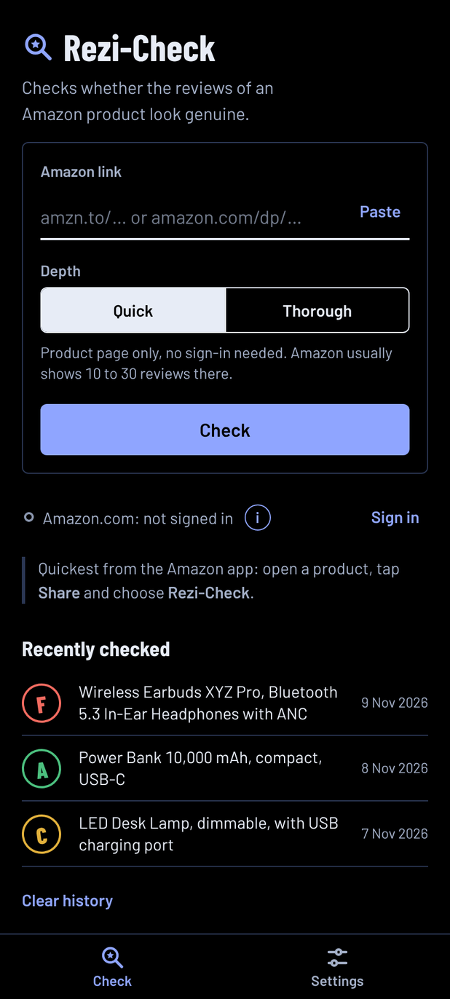
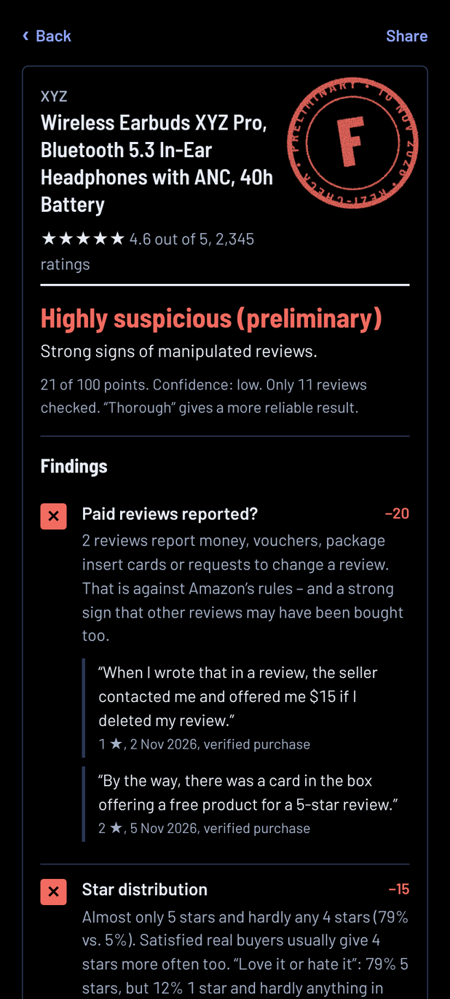
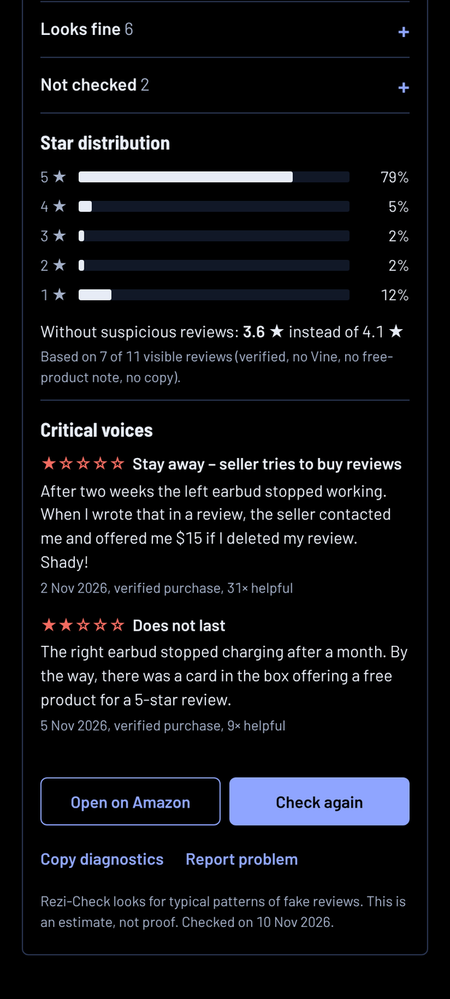

# Rezi-Check

Android app that checks whether the reviews of an Amazon product look genuine.

  
  
  

Rezi-Check loads the product page right on your phone, looks for typical patterns of fake reviews
and gives a grade from A to F – with reasons and quotes from the reviews as evidence.
(The products in the screenshots are made up.)

## Installation

1. Download the latest `Rezi-Check-….apk` from [Releases](https://github.com/Silvertax/rezi-check/releases/latest).
2. Open the file and allow installation from this source.
3. Done – works on Android 8 and later.

Tip: with [Obtainium](https://github.com/ImranR98/Obtainium) you get new versions automatically, straight from GitHub.

## How to use it

- In the Amazon app, open a product, tap **Share** and choose **Rezi-Check**.
- Or paste an Amazon link into the app and tap **Check**.
- **Quick** checks the product page only, no sign-in needed. Amazon usually shows 10 to 30 reviews there.
- **Thorough** also loads up to 50 critical and newest reviews. For this you sign in to Amazon once inside the app.
- **Language:** the app starts in your phone’s language (English or German). You can change it under
  **Settings → Language**; on Android 13 and later also in the Android settings under “App languages”.
- **Amazon store:** under **Settings → Amazon store** you choose which Amazon you sign in to for “Thorough”
  (e.g. Amazon.com, Amazon.co.uk, Amazon.de). You can check products from all of these stores.
- **When sharing:** by default the app asks whether to check quickly or thoroughly. Under **Settings → When sharing**
  you can make it start right away with the depth you chose last.

## What it checks

| Check | What Rezi-Check looks for |
|---|---|
| Paid reviews reported? | Buyers report money, vouchers or package insert cards offered for good reviews, or requests to change a review |
| Similar or copied texts | Reviews by different people with almost identical wording |
| Got the product for free | Positive reviews from people who got the product free or discounted outside Amazon Vine |
| Star distribution | Almost only 5 stars and hardly any 4 stars, or “love it or hate it” with nothing in between |
| Reviews older than the product | Hints that reviews were taken over from other products |
| Reviews don’t match the product | Several reviews are about a different kind of product and never mention this one |
| Ratings compared to sales | More ratings per month than the product sells |
| New vs. old reviews¹ | The newest reviews are clearly worse than the overall average |
| Bursts over time¹ | Waves of positive reviews within a few days |
| Further hints | Share of verified purchases and Vine testers, other buyers calling the reviews fake, praise without substance, brand names that look like random letters |

¹ only in “Thorough” mode

Each finding deducts points. The remaining points (0–100) give the grade. The best grade (A) is only given when at least
20 reviews were checked; with fewer than 12 reviews the grade is marked as preliminary.
The result is an estimate based on patterns, not proof.

## Privacy

- No server of its own, no tracking, no ads. The app only talks to Amazon – and, at most once a day, asks GitHub
  whether a new version is available. No personal data is sent; you can turn this off under **Settings → Check for updates**.
- History and your Amazon sign-in (cookies) stay on your phone. “Sign out” deletes the cookies.
- You enter your credentials directly on Amazon’s sign-in page. The app does not read them.

## Limitations

- Without signing in, Amazon shows only the selection on the product page (usually 10 to 30 reviews).
- Amazon may temporarily limit accounts whose behavior looks like automated reading to only a few reviews.
  “Thorough” therefore loads only a few pages, with pauses – still, use it sparingly.
- If Amazon changes its pages, the app may stop recognizing them. Then tap “Report problem” in the app –
  it opens a GitHub issue with the diagnostics already filled in.

## Roadmap

- [x] German and English interface (1.1)
- [x] Sign-in for “Thorough” at all major Amazon stores (1.1)
- [x] Pure black dark mode (1.2)
- [x] Info button explaining why sign-in is needed and what happens to your data (1.3)
- [x] Update notice in the app when a new version is released on GitHub (1.4)
- [x] “Report problem” button that opens a pre-filled GitHub issue with the diagnostics (1.4)
- [ ] Availability on F-Droid / IzzyOnDroid
- [x] New checks: reviews that don't match the product, and made-up brand names (1.4)
- [x] More honest grades when only a few reviews are visible (1.5)
- [x] Settings tab with feedback buttons, choice of depth when sharing, faster checks for shared links (1.5)
- [ ] Warning when “Thorough” is used very often, to protect your Amazon account from being limited
- [ ] Text patterns for reviews in French, Italian and Spanish
- [ ] Automated tests in the repository
- [ ] Releases built and signed automatically by GitHub
- [ ] More patterns for detecting fake reviews
- [ ] Review checks for other online shops besides Amazon

Ideas or wishes? Open an [issue](https://github.com/Silvertax/rezi-check/issues).

## Legal

Rezi-Check is a private open-source project and is not affiliated with Amazon.
Amazon is a trademark of Amazon.com, Inc. or its affiliates.
Amazon’s Conditions of Use prohibit automated data-gathering tools. The app only loads products you open
yourself, at the pace of a normal page view. Use at your own risk.

License: [MIT](LICENSE). Font Barlow: SIL Open Font License 1.1 (`app/src/main/assets/ui/fonts/OFL-Barlow.txt`).
