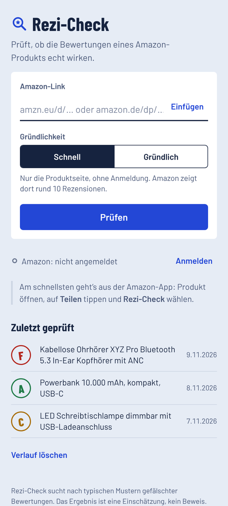
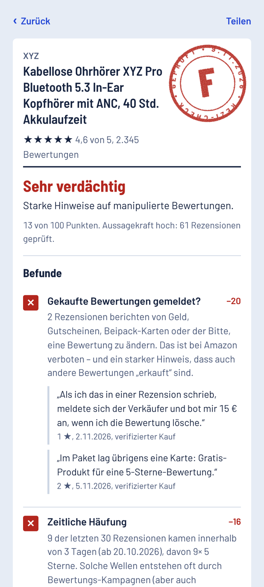
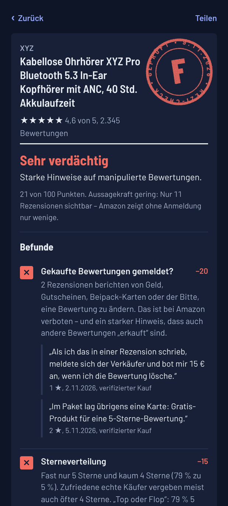

# Rezi-Check

**Deutsch** · [English](README.en.md)

Android-App, die prüft, ob die Bewertungen eines Amazon-Produkts echt wirken.

<p>
  
  
  
</p>

Rezi-Check lädt die Produktseite direkt auf deinem Handy, sucht nach typischen Mustern gefälschter
Bewertungen und vergibt eine Note von A bis F – mit Begründung und Zitaten aus den Rezensionen als Beleg.
(Die Produkte auf den Bildern sind ausgedacht.)

## Installation

1. Lade die neueste `Rezi-Check-….apk` unter [Releases](https://github.com/Silvertax/rezi-check/releases/latest) herunter.
2. Öffne die Datei und erlaube die Installation aus dieser Quelle.
3. Fertig – läuft ab Android 8.

Tipp: Mit [Obtainium](https://github.com/ImranR98/Obtainium) bekommst du neue Versionen automatisch direkt von GitHub.

## So benutzt du die App

- In der Amazon-App ein Produkt öffnen, auf **Teilen** tippen und **Rezi-Check** wählen.
- Oder einen Amazon-Link in die App einfügen und auf **Prüfen** tippen.
- **Schnell** prüft nur die Produktseite, ohne Anmeldung. Amazon zeigt dort rund 10 Rezensionen.
- **Gründlich** lädt zusätzlich bis zu 50 kritische und neueste Rezensionen. Dafür meldest du dich einmalig in der App bei Amazon an.
- **Sprache:** Die App startet in der Sprache deines Handys (Deutsch oder Englisch). Unter **Einstellungen → Sprache** kannst du sie umstellen;
  ab Android 13 geht das auch in den Android-Einstellungen unter „App-Sprache“.
- **Amazon-Shop:** Unter **Einstellungen → Amazon-Shop** wählst du, bei welchem Amazon du dich für „Gründlich“ anmeldest
  (z. B. Amazon.de, Amazon.com, Amazon.co.uk). Prüfen kannst du Produkte aus allen diesen Shops.

## Was geprüft wird

| Prüfung | Worauf Rezi-Check achtet |
|---|---|
| Gekaufte Bewertungen gemeldet? | Käufer berichten von Geld, Gutscheinen oder Beipack-Karten für gute Bewertungen oder von der Bitte, eine Bewertung zu ändern |
| Ähnliche oder kopierte Texte | Rezensionen verschiedener Personen mit fast gleichem Wortlaut |
| Produkt gratis bekommen | Positive Rezensionen von Leuten, die das Produkt außerhalb von Amazon Vine gratis oder vergünstigt bekommen haben |
| Sterneverteilung | Fast nur 5 Sterne und kaum 4 Sterne oder „Top oder Flop“ ohne Mittelfeld |
| Rezensionen älter als das Produkt | Hinweis auf von anderen Produkten übernommene Bewertungen |
| Bewertungen im Verhältnis zu Verkäufen | Mehr Bewertungen pro Monat, als das Produkt verkauft wird |
| Neue vs. alte Bewertungen¹ | Die neuesten Rezensionen sind deutlich schlechter als der Gesamtschnitt |
| Zeitliche Häufung¹ | Wellen positiver Rezensionen innerhalb weniger Tage |
| Weitere Hinweise | Anteil verifizierter Käufe und Vine-Tester, Fake-Vorwürfe anderer Käufer, Lob ohne Inhalt |

¹ nur im Modus „Gründlich“

Jeder Befund zieht Punkte ab. Aus den verbleibenden Punkten (0–100) ergibt sich die Note.
Das Ergebnis ist eine Einschätzung anhand von Mustern, kein Beweis.

## Datenschutz

- Kein eigener Server, kein Tracking, keine Werbung. Die App spricht nur mit Amazon.
- Verlauf und Amazon-Anmeldung (Cookies) bleiben auf deinem Handy. „Abmelden“ löscht die Cookies.
- Deine Zugangsdaten gibst du direkt auf Amazons Anmeldeseite ein. Die App liest sie nicht mit.

## Grenzen

- Ohne Anmeldung zeigt Amazon nur rund 10 Rezensionen pro Produkt.
- Amazon kann Konten, deren Verhalten nach automatischem Auslesen aussieht, vorübergehend auf wenige
  Rezensionen beschränken. „Gründlich“ lädt deshalb nur wenige Seiten mit Pausen – nutze es trotzdem sparsam.
- Baut Amazon seine Seiten um, erkennt die App unter Umständen nichts mehr. Tippe dann in der App auf
  „Diagnose kopieren“ und lege mit dem Text ein [Issue](https://github.com/Silvertax/rezi-check/issues) an.

## Selbst bauen

Voraussetzungen: JDK 17 oder neuer und das Android SDK (Plattform 36).

```sh
./gradlew assembleDebug
```

Die APK liegt danach unter `app/build/outputs/apk/debug/`.

Für eine signierte Release-Version legst du im Projektordner eine Datei `keystore.properties` an
(sie wird nicht mit eingecheckt):

```properties
storeFile=pfad/zum/schluessel.keystore
storePassword=…
keyAlias=…
keyPassword=…
```

Dann `./gradlew assembleRelease` ausführen.

### Aufbau

- `app/src/main/java/de/rezicheck/app/MainActivity.java` – App-Hülle: Oberfläche, unsichtbarer Amazon-WebView, Teilen-Ziel, Anmeldung
- `app/src/main/assets/extract.js` – liest Produktdaten, Sterneverteilung und Rezensionen aus der Amazon-Seite
- `app/src/main/assets/ui/analyze.js` – die Prüfungen und die Note
- `app/src/main/assets/ui/i18n.js` – deutsche und englische Texte
- `app/src/main/assets/ui/` – Oberfläche (HTML, CSS, JavaScript)

## Rechtliches

Rezi-Check ist ein privates Open-Source-Projekt und steht in keiner Verbindung zu Amazon.
Amazon ist eine Marke der Amazon.com, Inc. oder ihrer verbundenen Unternehmen.
Amazons Nutzungsbedingungen untersagen automatisierte Werkzeuge zum Sammeln von Daten. Die App lädt nur
Produkte, die du selbst aufrufst, im Tempo eines normalen Seitenaufrufs. Die Nutzung erfolgt auf eigene Verantwortung.

Lizenz: [MIT](LICENSE). Schriftart Barlow: SIL Open Font License 1.1 (`app/src/main/assets/ui/fonts/OFL-Barlow.txt`).

---

*English version: [README.en.md](README.en.md)*
